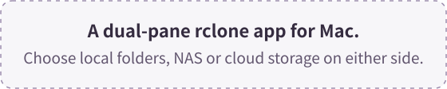
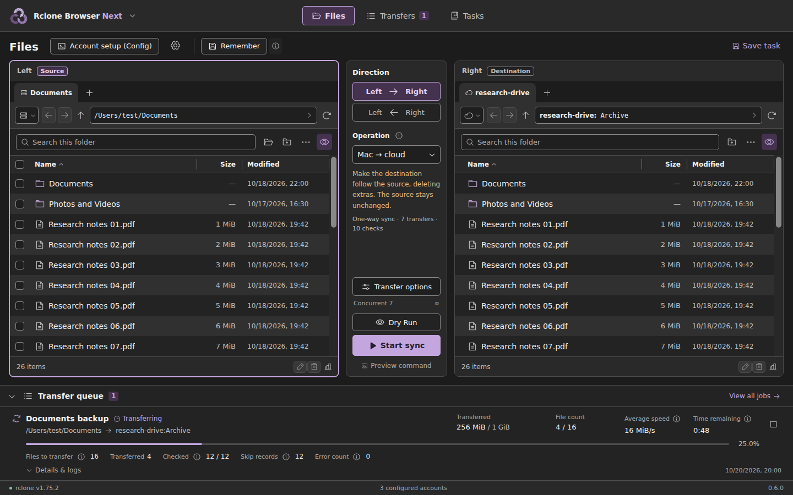

  

<h1 align="center">Rclone Browser Next</h1>

  

*Preview rendered by the app's frontend, using example files and paths.*

  <a href="https://github.com/jason840709/RcloneBrowserNext/releases/latest">Download</a> ·
  <a href="README.md">繁體中文</a> ·
  <a href="README.zh-TW.md">User guide (Traditional Chinese)</a> ·
  <a href="https://github.com/jason840709/RcloneBrowserNext/issues">Report an issue</a>

Mac is the primary platform, with Windows x64 and Linux amd64 compatibility editions. All platforms share one release version. [Latest release](https://github.com/jason840709/RcloneBrowserNext/releases/latest) · [Compatibility installation](docs/BUILD_COMPATIBILITY.md)

[0.9.5 hotfix notes](docs/RELEASE_0.9.5.md): fixes duplicated and stale display rows when navigating folders containing remote entries with the same name.

## What is it?

Rclone Browser Next is a macOS interface for [rclone](https://rclone.org/), developed by **Jason Chen**.
Choose a local folder, cloud location or NAS/server connection on either side, then use the central controls to set the direction and copy, move or sync files.

## Why build it?

On his own Mac, Jason ran into installation compatibility problems with an older Rclone Browser, along with unreliable speed and remaining-time displays when using current rclone.
He wanted to keep its graphical workflows while improving Mac compatibility and transfer reporting.

**The original app's default workflow focuses on uploads and downloads between local and cloud storage.** Next makes both locations independent, bringing local-to-local and cloud-to-cloud transfers into the same workflow.
rclone still performs the transfers; the change is how the interface lets you set them up.

## How it differs from Rclone Browser 1.8

### Choose either location freely

Pick the two locations, then choose the transfer direction. A NAS can be a folder mounted in Finder or a remote configured in rclone.

| Transfer combination | Example |
| --- | --- |
| Local ↔ Local | Copy or back up between Mac folders, external drives and mounted NAS shares |
| Local ↔ Cloud | Upload local files or download cloud files to your Mac |
| Cloud ↔ Cloud | Copy, move or sync between two configured cloud locations |

Direct cloud-to-cloud copying depends on backend support. Transfers between different services normally still pass through the Mac running rclone. [How the data travels](https://rclone.org/faq/#can-rclone-sync-directly-from-drive-to-s3)

### Apple Silicon support, using system components

The app uses Swift, AppKit and macOS's built-in WebKit, with Apple Silicon and Intel builds. rclone is installed separately in the folder you choose.
Using the system's interface components keeps a separate browser engine out of the app bundle. [Architecture and build guide](docs/DEVELOPMENT.md)

### Tabs, tasks and transfer history

Dry Run and Tasks carry forward important features from the original app. Next places them alongside the folder panes and adds details for everyday use:

- **Folder tabs:** each pane keeps its own tabs and navigation history, including back and forward with mouse side buttons.
- **Cached browsing and cancellation:** each pane reuses a bounded session cache for remote folders. Refresh clears that pane at every depth; cancelling a listing preserves the last successful location.
- **Previews and saved tasks:** inspect proposed actions with Dry Run; save a setup as a Task to run, preview, edit or delete later.
- **Backup presets:** choose from six common combinations of local folders, NAS and cloud storage, then adjust comparison and exclusion rules as needed.
- **Remember workspace:** restore both folders and transfer settings at the next launch, without starting a job automatically.
- **Progress and notices:** see average speed, estimated time and percentages to one decimal place; temporary notices float above the interface without moving the layout.
- **Job history:** see checked and required-transfer counts separately, with per-file skip, completion and error reports. Stop, retry or clear jobs; a stopping job remains visible until rclone actually exits.
- **Themes and languages:** six themes, with dark and light versions of purple, blue and green, plus five interface sizes; Traditional Chinese, English and Japanese, with a system-language option.

Sync is one-way: **the source is the reference, only the destination changes, and extra destination files may be deleted.** Comparison, exclusion and skip rules still affect the scope. Use a preview before running. [Full user guide](README.zh-TW.md)

NAS presets compare size and modification time without computing local hashes by default. This reduces the need to read whole NAS files back just for comparison, at the cost of local content-hash verification. You can adjust the options; the [NAS comparison guide](docs/NAS_COMPARISON.zh-TW.md) explains the tradeoffs.

### Separate rclone and app updates

Check for rclone updates at startup or manually, then choose to update, postpone or skip a version. After confirmation, the updater downloads and replaces the engine at the selected installation location.
A separate “Check Rclone Next updates” action checks this project's releases and offers a download page when a newer version is available. Updating the engine does not require rebuilding the app.

## Quick start

Requires **macOS 13 or later**. Local builds use an existing **Xcode or Apple Command Line Tools** installation.

1. Download the local build package from the [latest release](https://github.com/jason840709/RcloneBrowserNext/releases/latest) and extract the complete folder.
2. Double-click `Build-on-Mac.command`. It creates and opens the app in the same folder.
3. Choose the **rclone installation location** in Settings, using an existing engine or downloading it into your selected folder. Open **Account setup → Quick setup**, enter a nickname and choose a service. Google Drive, OneDrive and Dropbox use browser sign-in; server connections request their necessary address and credentials. Custom options are grouped under **Detailed setup**, and the adjacent **config** link keeps terminal configuration available. Choose both locations and run a preview before transferring files.

The build does not install developer tools, Homebrew, Node.js or rclone. Build caches and outputs stay inside the project folder.
App bundles use an **ad-hoc signature**, without Developer ID signing or Apple notarization. If Gatekeeper blocks a download, follow the [Mac build guide](docs/BUILD_MAC.zh-TW.md).

## Documentation and feedback

The detailed user documentation is currently in Traditional Chinese; the development guide is in English.

| Document | Contents |
| --- | --- |
| [User guide](README.zh-TW.md) | Browsing, transfers, Tasks, settings and updates |
| [Build on Mac](docs/BUILD_MAC.zh-TW.md) | Requirements, file locations, signing and troubleshooting |
| [NAS comparison](docs/NAS_COMPARISON.zh-TW.md) | Ways to reduce extra content reads and the tradeoffs in comparison accuracy |
| [Feature comparison](docs/FEATURE_MATRIX.zh-TW.md) | Retained features, implementation and differences from the original |
| [Changelog](docs/CHANGELOG.zh-TW.md) | Changes in each version |
| [Development](docs/DEVELOPMENT.md) · [Validation](docs/VALIDATION.zh-TW.md) | Building from source, test methods and verified scope |

For problems or feature suggestions, open an [issue](https://github.com/jason840709/RcloneBrowserNext/issues) with the steps, app/rclone versions and macOS version.

## Author and acknowledgments

Author: **Jason Chen**. Released under the [MIT License](LICENSE). Jason Chen supplied the app icon.

- [rclone](https://rclone.org/) and its contributors provide the storage connections and transfer engine.
- [mmozeiko/RcloneBrowser](https://github.com/mmozeiko/RcloneBrowser) is the original Rclone Browser project and the foundation for its graphical workflows.
- [kapitainsky/RcloneBrowser](https://github.com/kapitainsky/RcloneBrowser) continued maintenance and feature development, providing workflows and features studied for this project.

Next is an independent Swift/AppKit and React implementation, rather than an official release of the original project.
Third-party frontend notices accompany the [web resources](Resources/Web/THIRD_PARTY_NOTICES.txt).
