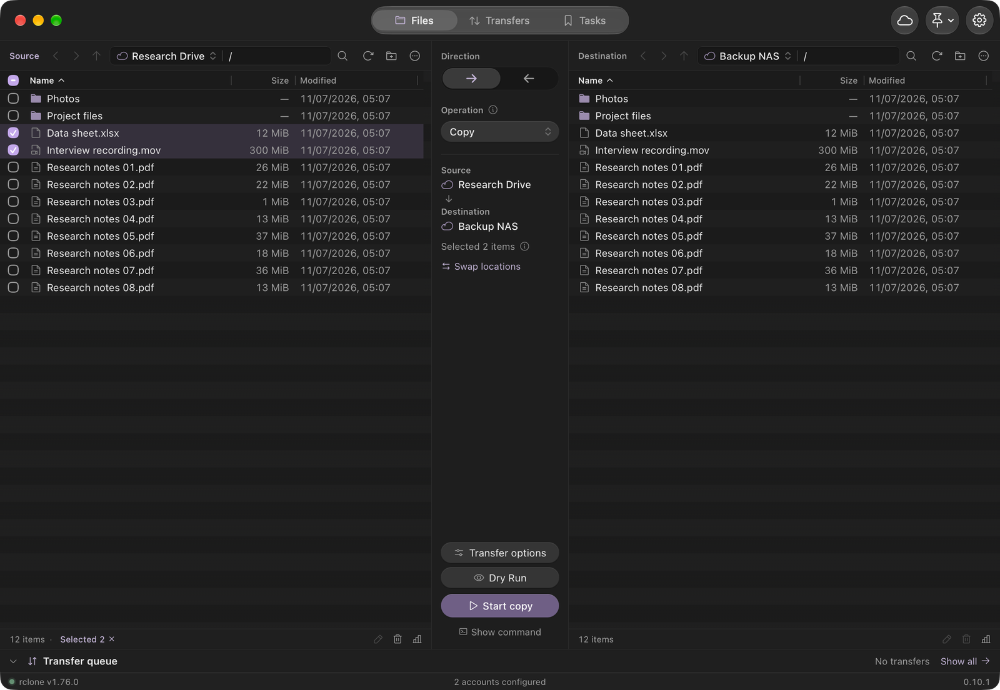
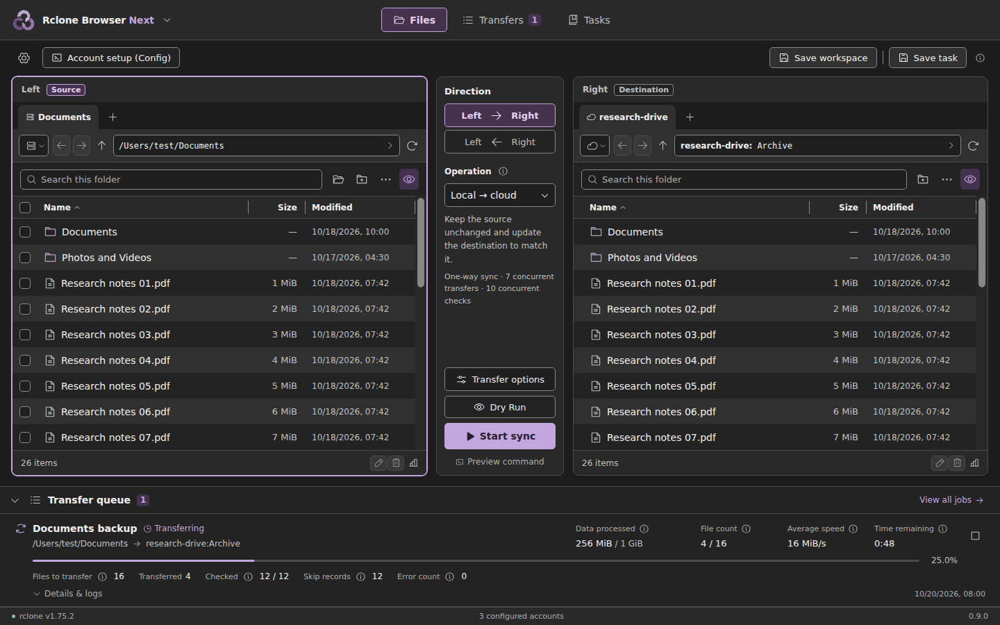

  

<h1 align="center">Rclone Browser Next</h1>

  

*The actual 0.10.1 Mac app, shown with test accounts and sample files. The Windows and Linux editions use the same interface inside their own system window frames.*

  <a href="https://github.com/jason840709/RcloneBrowserNext/releases/latest">Download</a> ·
  <a href="README.md">繁體中文</a> ·
  <a href="docs/USER_GUIDE.zh-TW.md">User guide (Traditional Chinese)</a> ·
  <a href="https://github.com/jason840709/RcloneBrowserNext/issues">Report an issue</a>

## What is it?

Rclone Browser Next is a graphical interface for [rclone](https://rclone.org/), developed by **Jason Chen**, for Mac, Windows and Linux.
Choose a local folder, cloud location or NAS/server connection on either side, then use the central controls to set the direction and copy, move or sync files. rclone performs the transfers.

## Supported systems and stability

All three systems share one version number and are released together.

| System | File to download | Stability |
| --- | --- | --- |
| macOS 13 or later (Apple silicon, Intel) | `macOS_arm64.zip` (Apple silicon) or `macOS_x86_64.zip` (Intel) | **Most stable.** The app is developed on a Mac and used there every day; each release runs the full native and interface test suites on GitHub's Mac runners. |
| Windows x64 | `Windows_x64_Setup.exe` | Built on GitHub's cloud runners, then installed on a clean Windows runner that tests file operations, copying and upgrades from earlier versions. The author does not use it daily on a physical Windows PC, so it may be less stable than the Mac edition. |
| Linux (Ubuntu 24.04 amd64) | `Linux_amd64.deb` | Built on GitHub's Ubuntu runner with automated file-operation, copy and cancellation tests. The author does not use it daily, so it may be less stable than the Mac edition. Other distributions need matching dependencies or a source build. |

The Windows and Linux editions share the Mac edition's interface and transfer core: browsing, copy, one-way sync, move, Dry Run, Tasks and per-file reports. Finder integration, the menu bar item and mounting are available only on Mac. [Windows/Linux installation and builds](docs/BUILD_COMPATIBILITY.md)

**If you run into any problem on any system, please open an [issue](https://github.com/jason840709/RcloneBrowserNext/issues).** Nobody has reported one yet, and no problem is too small. Reports from Windows and Linux are especially helpful, because the author does not use those systems day to day.

## Recent versions

- [0.10.3](docs/RELEASE_0.10.3.md): while files wait for the cloud to confirm them, the speed stays visible with a small busy ring; hover hints cover whole items; the Mac toolbar keeps its look without glass circles.
- [0.10.2](docs/RELEASE_0.10.2.md): speed counts only time with files transferring; counts show what happened to each file; errors become small plain-language lights.
- [0.10.1](docs/RELEASE_0.10.1.md): fixes the list bouncing back when scrolled to the end, settings hints that did not disappear, and more.
- [0.10.0](docs/RELEASE_0.10.0.md): a redesigned interface with automatic light/dark appearance and low-saturation colors.

See the [changelog](docs/CHANGELOG.zh-TW.md) (Traditional Chinese) for every version.

## Why build it?

On his own Mac, Jason ran into installation compatibility problems with an older Rclone Browser, along with unreliable speed and remaining-time displays when using current rclone.
He wanted to keep its graphical workflows while improving compatibility and transfer reporting.

**The original app's default workflow focuses on uploads and downloads between local and cloud storage.** Next makes both locations independent, bringing local-to-local and cloud-to-cloud transfers into the same workflow.

## How it differs from Rclone Browser 1.8

### Choose either location freely

Pick the two locations, then choose the transfer direction. A NAS can be a folder mounted by the system or a remote configured in rclone.

| Transfer combination | Example |
| --- | --- |
| Local ↔ Local | Copy or back up between folders on your computer, external drives and mounted NAS shares |
| Local ↔ Cloud | Upload local files or download cloud files |
| Cloud ↔ Cloud | Copy, move or sync between two configured cloud locations |

Direct cloud-to-cloud copying depends on backend support. Transfers between different services normally still pass through the computer running rclone. [How the data travels](https://rclone.org/faq/#can-rclone-sync-directly-from-drive-to-s3)

### Built on system components

The Mac edition uses Swift, AppKit and macOS's built-in WebKit, for Apple silicon and Intel. The Windows and Linux editions use the same interface and transfer core, hosted by Tauri with the system webview (WebView2 on Windows, WebKitGTK on Linux).
None of them bundles a separate browser engine; rclone is installed separately in the folder you choose. [Architecture and build guide](docs/DEVELOPMENT.md)

### Tabs, tasks and transfer history

Dry Run and Tasks carry forward important features from the original app. Next places them alongside the folder panes and adds details for everyday use:

- **Folder tabs:** each pane keeps its own tabs and navigation history, including back and forward with mouse side buttons.
- **Cached browsing and cancellation:** each pane reuses a bounded session cache for remote folders. Refresh clears that pane at every depth; cancelling a listing preserves the last successful location.
- **Previews and saved tasks:** inspect proposed actions with Dry Run; save a setup as a Task to run, preview, edit or delete later.
- **Backup presets:** choose from six common combinations of local folders, NAS and cloud storage, then adjust comparison and exclusion rules as needed.
- **Remember workspace:** restore both folders and transfer settings at the next launch, without starting a job automatically.
- **Progress and speed:** speed counts only time with files transferring, alongside the remaining time and a percentage to one decimal place. While rclone compares files or waits for the cloud to confirm them, a small ring appears next to the speed; hover over it to see what it is waiting for.
- **Job history:** see how many files needed no update, were skipped or were deleted, plus the error count, with per-file reports. Errors are explained in plain language: orange when rclone retries by itself, red when you need to act. Stop, retry or clear jobs.
- **Themes and languages:** purple, blue and green, each in light and dark, plus five interface sizes; Traditional Chinese, English and Japanese, with a system-language option.

Sync is one-way: **the source is the reference, only the destination changes, and extra destination files may be deleted.** Comparison, exclusion and skip rules still affect the scope. Use a preview before running. [Full user guide](docs/USER_GUIDE.zh-TW.md) (Traditional Chinese)

NAS presets compare size and modification time without computing local hashes by default. This reduces the need to read whole NAS files back just for comparison, at the cost of local content-hash verification. You can adjust the options; the [NAS comparison guide](docs/NAS_COMPARISON.zh-TW.md) explains the tradeoffs.

### Separate rclone and app updates

Check for rclone updates at startup or manually, then choose to update, postpone or skip a version. After confirmation, the app downloads and replaces rclone at the selected installation location.
A separate “Check Rclone Next updates” action checks this project's releases and offers a download page when a newer version is available.

## Quick start

1. Download the file for your system from the [latest release](https://github.com/jason840709/RcloneBrowserNext/releases/latest) and install it:
   - **Mac:** extract the zip and drag `Rclone Browser Next.app` into Applications. The app has a local (ad-hoc) signature and is not yet notarized by Apple. If macOS blocks the first launch, open System Settings → Privacy & Security, scroll down to Rclone Browser Next and click the Open button next to it.
   - **Windows:** run the `Setup.exe`. It installs for the current user without administrator rights. The installer has no Windows code signature; if SmartScreen warns you, choose “More info”, then “Run anyway”. If WebView2 is missing, the installer downloads Microsoft's official version.
   - **Linux (Ubuntu 24.04):** open the `.deb` with your package installer, or run `sudo apt install ./Rclone_Browser_Next_<version>_Linux_amd64.deb`.
2. In Settings, choose the **rclone installation location**: use an existing rclone or download it into a folder you choose.
3. Open **Account setup → Quick setup**, enter a nickname and choose a service. Google Drive, OneDrive and Dropbox use browser sign-in; server connections ask for their address and credentials. Custom options are under **Detailed setup**, and the adjacent **config** link keeps terminal configuration available.
4. Choose both locations, run a **Dry Run** to see what will happen, then start the transfer.

To build from source: on Mac, download `Source.zip` from the same page and double-click `Build-on-Mac.command` ([Mac build guide](docs/BUILD_MAC.zh-TW.md), Traditional Chinese); for Windows and Linux, see the [compatibility build guide](docs/BUILD_COMPATIBILITY.md).

## Earlier interface (0.9.6 and before)

Versions up to 0.9.6 used an interface designed with ChatGPT, shown below. From 0.10.0 the app uses a new design; transfers, comparison and account setup work the same way. If you prefer the earlier look, download 0.9.6 from its [release page](https://github.com/jason840709/RcloneBrowserNext/releases/tag/v0.9.6).

## Documentation and feedback

The detailed user documentation is currently in Traditional Chinese; the development and compatibility guides are in English.

| Document | Contents |
| --- | --- |
| [User guide](docs/USER_GUIDE.zh-TW.md) | Browsing, transfers, Tasks, settings and updates |
| [Windows/Linux installation and builds](docs/BUILD_COMPATIBILITY.md) | Installing and building the compatibility editions, and their automated test scope |
| [Build on Mac](docs/BUILD_MAC.zh-TW.md) | Building the Mac edition from source, file locations, signing and troubleshooting |
| [NAS comparison](docs/NAS_COMPARISON.zh-TW.md) | Ways to reduce extra content reads and the tradeoffs in comparison accuracy |
| [Feature comparison](docs/FEATURE_MATRIX.zh-TW.md) | Retained features, implementation and differences from the original |
| [Changelog](docs/CHANGELOG.zh-TW.md) | Changes in each version |
| [Development](docs/DEVELOPMENT.md) · [Validation](docs/VALIDATION.zh-TW.md) | Building from source, test methods and verified scope |

Questions, problems and feature suggestions are all welcome in [Issues](https://github.com/jason840709/RcloneBrowserNext/issues). Please include your operating system and version, the app and rclone versions, and the steps you took; screenshots help.

## Author and acknowledgments

Author: **Jason Chen**. Released under the [MIT License](LICENSE). Jason Chen supplied the app icon.

- [rclone](https://rclone.org/) and its contributors provide the storage connections and transfer engine.
- [mmozeiko/RcloneBrowser](https://github.com/mmozeiko/RcloneBrowser) is the original Rclone Browser project and the foundation for its graphical workflows.
- [kapitainsky/RcloneBrowser](https://github.com/kapitainsky/RcloneBrowser) continued maintenance and feature development, providing workflows and features studied for this project.

Next is an independent project rather than an official release of the original: the interface is written in React, the Mac window in Swift/AppKit, the Windows and Linux windows in Tauri, and all editions share a Swift transfer core.
Third-party frontend notices accompany the [web resources](Resources/Web/THIRD_PARTY_NOTICES.txt).
