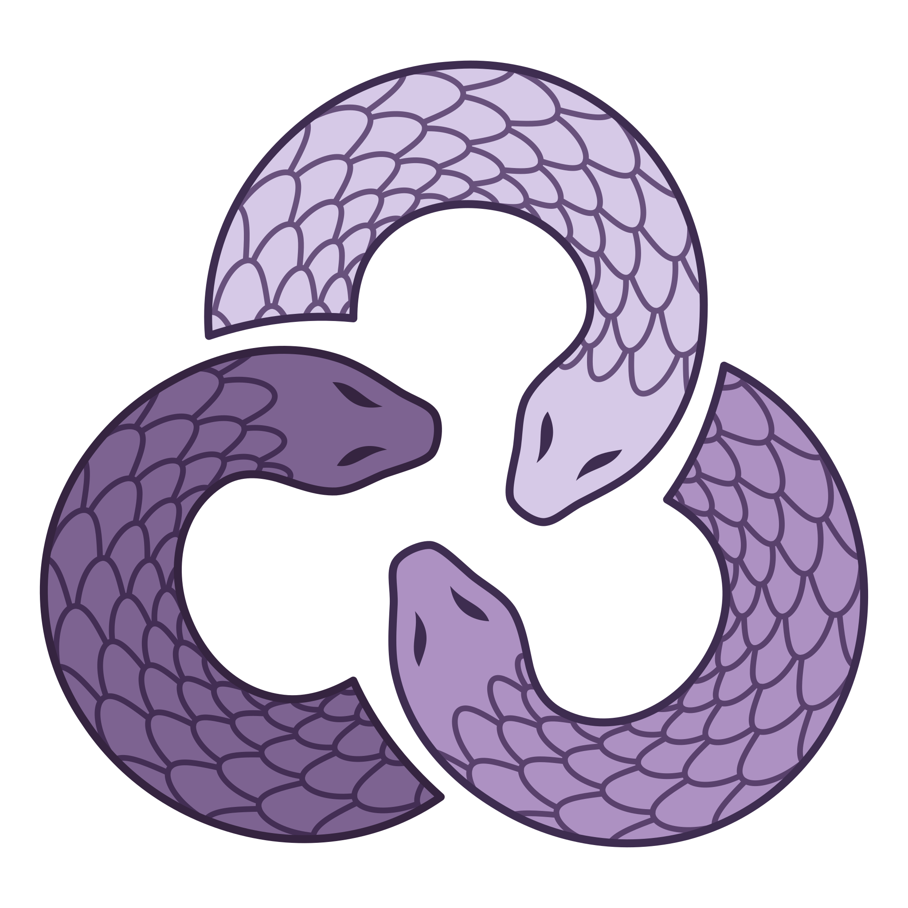
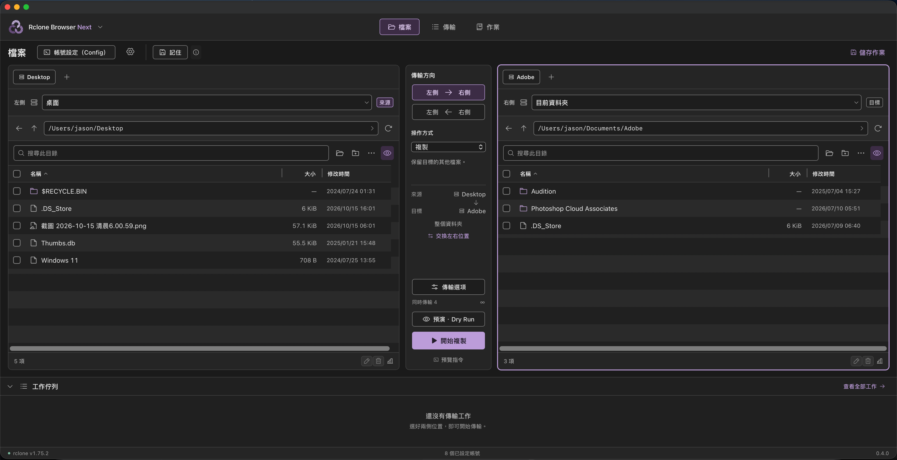

# Rclone Browser Next

**A fresh rclone interface for today's Mac.** Native Apple Silicon builds, a redesigned dual-pane workspace, and local, cloud and NAS storage in one window.

[繁體中文](README.md) · [Download 0.4.0](https://github.com/jason840709/RcloneBrowserNext/releases/latest) · [User guide (繁體中文)](docs/USER_GUIDE.zh-TW.md) · [Development](docs/DEVELOPMENT.md)

Browse two locations, check the direction, and copy, move or sync. Preview changes with Dry Run, follow jobs, and save repeatable tasks with their transfer options.

## Why Next exists

[rclone](https://rclone.org/) connects many storage services. [Rclone Browser](https://github.com/kapitainsky/RcloneBrowser) made those capabilities accessible through a desktop interface. Next builds on that idea with a new implementation focused on current Macs: native Apple Silicon builds and a workspace that keeps the source, destination and transfer controls together.

Developed by **Jason Chen**, Next uses Swift, AppKit and the system WebKit, with a React interface. It does not bundle Electron, Chromium, Qt or the rclone executable.

## What changes in daily use

- **Native Mac builds:** macOS 13+, arm64 for Apple Silicon (including M1–M4) and x86_64 for Intel. The local build selects the hardware architecture.
- **A redesigned workspace:** independent tabs and locations in each pane, search, editable paths and resizable columns. Direction and operation controls sit between the panes, with jobs below.
- **Preview and reuse:** Dry Run, editable saved tasks, and workspace restoration that does not start transfers automatically.
- **Appearance and language:** purple or blue accents on light or dark surfaces; Traditional Chinese, English and Japanese.
- **NAS comparison choices:** compare mounted NAS files by size and modification time without local content hashing. Changes that preserve both size and time may be missed; see [comparison tradeoffs](docs/NAS_COMPARISON.zh-TW.md).

The original Rclone Browser already offered jobs, tasks and dark mode. Next continues these ideas while rebuilding the Mac application and reorganizing the interface. It currently targets macOS, whereas the original project supports multiple platforms. See the [feature comparison](docs/FEATURE_MATRIX.zh-TW.md) for retained functions and differences.

## Get started

Version 0.4.0 is distributed as a **source build package**. You need an existing Xcode or Apple Command Line Tools installation. The app uses an ad-hoc local signature and is not Developer ID signed or Apple notarized; building on your own Mac is the recommended route.

1. Download and extract the complete source package from [Releases](https://github.com/jason840709/RcloneBrowserNext/releases/latest).
2. Double-click `Build-on-Mac.command` to create the app. This does not install development tools, Node.js or rclone.
3. Select your separately installed rclone in Settings. Use **Account setup (Config)** to configure remotes.
4. Choose both locations, direction and operation. Run **Dry Run** before transferring.

**Sync may delete destination files; Move removes corresponding source items after successful transfer.** Start with test data.

[Mac build guide](docs/BUILD_MAC.zh-TW.md) · [Detailed user guide](docs/USER_GUIDE.zh-TW.md) · [Validation scope](docs/VALIDATION.zh-TW.md)

## Credits and license

Next is an independent implementation inspired by the Rclone Browser family, not an official release of those projects. Thanks to [rclone](https://rclone.org/), [mmozeiko/RcloneBrowser](https://github.com/mmozeiko/RcloneBrowser), [kapitainsky/RcloneBrowser](https://github.com/kapitainsky/RcloneBrowser) and its contributors, and [downer08tutti/RcloneBrowser2](https://github.com/downer08tutti/RcloneBrowser2). ForkLift informed the dual-pane interaction design; its code and private assets are not distributed here.

By **Jason Chen**, under the [MIT License](LICENSE). Icon supplied by Jason Chen. [Third-party web notices](Resources/Web/THIRD_PARTY_NOTICES.txt) and [acknowledgments](docs/ACKNOWLEDGMENTS.md) are included.
