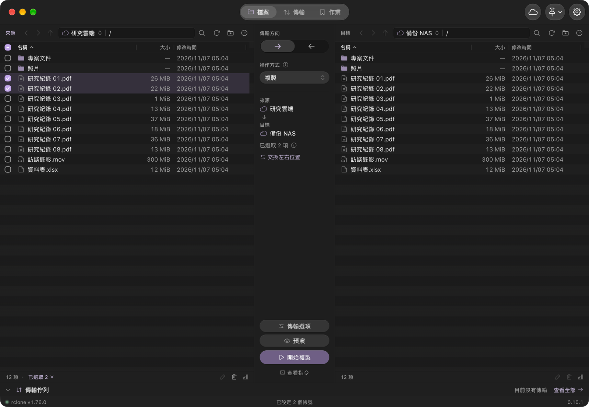

  

# Rclone Browser Next

Mac、Windows、Linux で使える [rclone](https://rclone.org/) のファイル管理アプリです。左右のペインでローカルフォルダー、クラウド、NAS／サーバーを選び、中央のボタンで転送方向と操作を指定します。ファイルの転送は rclone が行います。

[正式版をダウンロード](https://github.com/jason840709/RcloneBrowserNext/releases/latest) · [繁體中文](README.md) · [English](README.en.md) · [不具合を報告](https://github.com/jason840709/RcloneBrowserNext/issues)

この画像は 0.10.1 の Mac 版です。表示している接続先とファイルはテスト用です。Windows と Linux も同じ画面構成を使い、ウィンドウ枠は各システムのものになります。

## 主な機能

- 左右それぞれにフォルダーのタブと移動履歴を保持。
- ローカル同士、ローカルとクラウド、クラウド同士のコピー・移動・一方向同期。
- NAS への接続は、システムでマウントしたフォルダーと SMB 直接接続に対応。
- 実行前のプレビュー、後から再実行できる作業の保存。
- 転送履歴、エラーの説明、ファイルごとの処理記録。
- ライト／ダーク表示、紫・青・緑の配色、5 段階の画面サイズ。
- 繁体字中国語、英語、日本語。

同期は一方向です。**転送元を基準に転送先を変更し、転送先にしかないファイルは削除することがあります。** 比較方法、除外、スキップの設定によって処理範囲が変わるため、まずプレビューで確認してください。

クラウド間の直接コピーはサービス側の対応によります。異なるサービス間では通常、このアプリを動かすコンピューターを経由します。Finder 連携、メニューバーとマウント機能は Mac 版のみです。

## インストールと使い始め方

Mac は macOS 13 以降の Apple シリコン／Intel に対応します。Windows は x64 版、Linux の配布パッケージは Ubuntu 24.04 amd64 向けです。配布ページで自分のシステム用のファイルを選んでください。

1. 正式版をダウンロードしてインストールします。Mac は展開したアプリを「アプリケーション」へ移動します。Windows はインストーラー、Ubuntu はパッケージインストーラーで導入できます。
2. 設定画面で rclone の保存先を選びます。既存の rclone を指定するか、選んだフォルダーへダウンロードできます。
3. アカウント設定で接続先を追加します。Google Drive、OneDrive、Dropbox などはブラウザーで認証し、サーバー接続ではアドレスや認証情報を入力します。
4. 転送元と転送先、方向、操作を確認し、プレビューを実行してから転送を開始します。

Mac 版はローカル署名で、Apple の公証は受けていません。初回起動がブロックされた場合は、システム設定の「プライバシーとセキュリティ」からアプリを許可してください。Windows のインストーラーもコード署名はありません。WebView2 がない場合は Microsoft の公式配布元から取得します。

[操作ガイド（繁体字中国語）](docs/USER_GUIDE.zh-TW.md) · [Mac でのビルド（繁体字中国語）](docs/BUILD_MAC.zh-TW.md) · [Windows／Linux のインストールとビルド（英語）](docs/BUILD_COMPATIBILITY.md)

## 0.12.2 の変更

0.12.0 で画面を切り替えるとちらつく問題を修正しました。

## 0.12.1 の変更

「転送」から「ファイル」に戻った直後、一覧が一瞬空白になる問題を修正しました。画面デザインとページ切り替えのアニメーションはそのままです。

## 0.12.0 の変更

Windows と Linux のインストール用ファイルが小さくなりました。画面と操作方法はそのままで、既存の設定、保存した作業、転送履歴を引き続き利用できます。

[各バージョンの変更（繁体字中国語）](docs/CHANGELOG.zh-TW.md)

## 作者・ライセンス

作者は **Jason Chen** です。[MIT ライセンス](LICENSE)で公開しています。rclone とその貢献者、および元の Rclone Browser を作った [mmozeiko](https://github.com/mmozeiko/RcloneBrowser)、開発を継続した [kapitainsky](https://github.com/kapitainsky/RcloneBrowser) と貢献者の皆さまに感謝します。Next は独立したプロジェクトで、元の開発者による公式版ではありません。

問題があれば、OS とそのバージョン、アプリと rclone のバージョン、操作手順を添えて報告してください。
