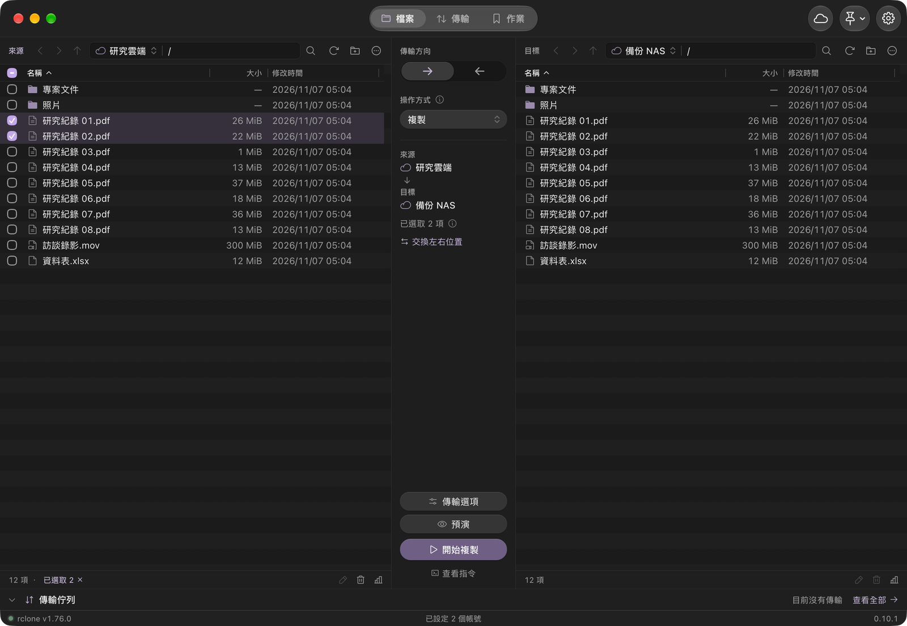
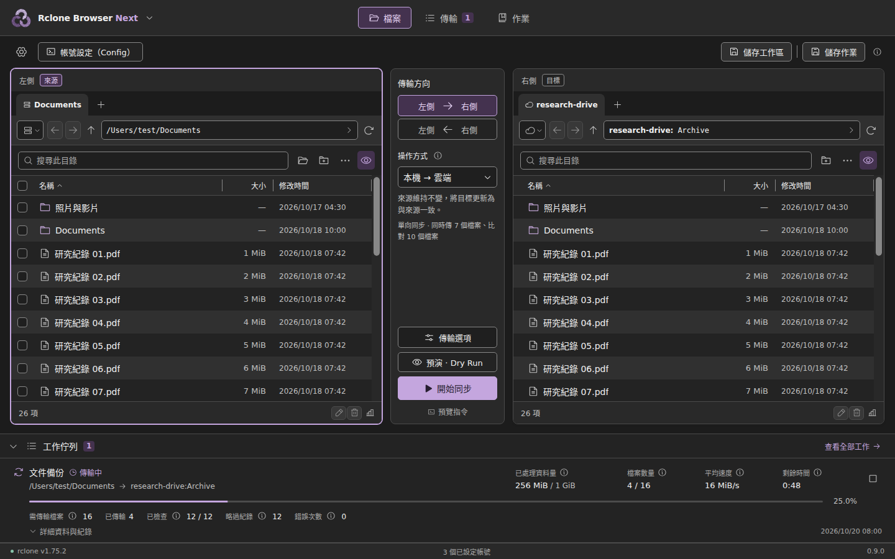

  

<h1 align="center">Rclone Browser Next</h1>

  

*0.10.1 Mac 版的實際畫面，使用測試帳號與示意檔案。Windows 與 Linux 版使用同一套介面，只有視窗外框跟著各系統。*

  <a href="https://github.com/jason840709/RcloneBrowserNext/releases/latest">下載</a> ·
  <a href="README.en.md">English</a> ·
  <a href="docs/USER_GUIDE.zh-TW.md">使用手冊</a> ·
  <a href="https://github.com/jason840709/RcloneBrowserNext/issues">回報問題</a>

## 這是什麼？

Rclone Browser Next 是由 **Jason Chen** 開發的 [rclone](https://rclone.org/) 圖形介面，Mac、Windows、Linux 都能使用。
左右兩邊都能選擇本機資料夾、雲端空間或 NAS／伺服器，再從中央選擇方向，複製、移動或同步檔案。實際的傳輸由 rclone 執行。

## 支援的系統與穩定程度

三個系統使用同一個版本號，每次發布同時提供。

| 系統 | 下載的檔案 | 穩定程度 |
| --- | --- | --- |
| macOS 13 以上（Apple 晶片、Intel） | `macOS_arm64.zip`（Apple 晶片）或 `macOS_x86_64.zip`（Intel） | **最穩定。** App 在 Mac 上開發，作者每天實際使用；每次發布都在 GitHub 的 Mac 測試機上跑完整的原生與介面測試。 |
| Windows x64 | `Windows_x64_Setup.exe` | 由 GitHub 的雲端測試機建置，並在乾淨的 Windows 測試機上自動安裝、測試檔案操作與複製，也測試從舊版升級。作者沒有在實體 Windows 電腦上日常使用，可能沒有 Mac 版穩定。 |
| Linux（Ubuntu 24.04 amd64） | `Linux_amd64.deb` | 由 GitHub 的 Ubuntu 測試機建置，自動測試檔案操作、複製與取消。作者沒有日常使用，可能沒有 Mac 版穩定。其他發行版需要自行安裝相依套件或從原始碼建置。 |

Windows 與 Linux 版使用和 Mac 版相同的介面與傳輸核心，提供瀏覽、複製、單向同步、移動、預演、作業與逐檔報告。Finder 整合、選單列圖示與掛載只有 Mac 版有。[Windows／Linux 安裝與建置](docs/BUILD_COMPATIBILITY.md)

**在任何系統上遇到問題，都歡迎到 [Issues](https://github.com/jason840709/RcloneBrowserNext/issues) 提出。** 目前還沒有人回報過，問題再小都沒關係；Windows 和 Linux 的回報特別有幫助，因為作者平常用不到這兩個系統。

## 最近的版本

- [0.10.3](docs/RELEASE_0.10.3.md)：rclone 在等雲端確認檔案時，速度照常顯示並加上小轉圈；滑鼠提示涵蓋整個項目；Mac 版工具列維持原本沒有圓圈的樣子。
- [0.10.2](docs/RELEASE_0.10.2.md)：傳輸速度只算真正在傳的時間；統計數字改成檔案去向；錯誤改成小燈號並翻成白話。
- [0.10.1](docs/RELEASE_0.10.1.md)：修正捲到底會往上彈、設定提示不會消失等問題。
- [0.10.0](docs/RELEASE_0.10.0.md)：介面重新設計，自動淺色／深色外觀與低飽和配色。

所有版本的內容見 [修改記錄](docs/CHANGELOG.zh-TW.md)。

## 為什麼做 Next？

Jason 在自己的 Mac 上遇過舊版 Rclone Browser 的安裝相容性問題；搭配現行 rclone 使用時，速度和剩餘時間的顯示也不可靠。
他因此希望保留原版的圖形操作流程，同時改善相容性和傳輸資訊。

**原版的預設工作流程側重本機與雲端之間的上傳、下載。** Next 讓左右位置都能自由選擇，把本機對本機、雲端對雲端也放進同一套操作流程。

## 與 Rclone Browser 1.8 的差異

### 左右位置都能自由選

選好兩邊，再決定往哪個方向傳。NAS 可以使用系統已掛載的資料夾，也可以使用 rclone 設定的遠端連線。

| 傳輸組合 | 使用範例 |
| --- | --- |
| 本機 ↔ 本機 | 電腦上的資料夾、外接硬碟、已掛載的 NAS 之間複製或備份 |
| 本機 ↔ 雲端 | 將本機資料上傳，或把雲端資料下載回來 |
| 雲端 ↔ 雲端 | 在兩個已設定的雲端位置之間複製、移動或同步 |

雲端之間能否直接複製，取決於服務支援；跨服務傳輸的資料通常仍會經過執行 rclone 的電腦。[傳輸路徑說明](https://rclone.org/faq/#can-rclone-sync-directly-from-drive-to-s3)

### 使用系統內建的元件

Mac 版用 Swift／AppKit 與 macOS 內建的 WebKit，支援 Apple 晶片與 Intel。Windows 與 Linux 版用同一套介面和傳輸核心，透過 Tauri 搭配系統內建的網頁元件（Windows 的 WebView2、Linux 的 WebKitGTK）。
三個系統都不必把另一套瀏覽器引擎放進 App；rclone 另外安裝在你選的資料夾。[架構與建置說明](docs/DEVELOPMENT.md)

### 分頁、作業與傳輸記錄

Dry Run 和 Tasks 是延續原版的重要功能。Next 把它們與雙面板放在一起，並補上日常操作需要的細節：

- **資料夾分頁：** 左右各自保留分頁與瀏覽歷史，可用滑鼠側鍵返回、前進。
- **瀏覽快取與取消：** 回訪雲端資料夾可重用各窗格的工作階段快取；重新整理清除該側所有層級，載入可取消並保留上一次成功的位置。
- **預演與儲存作業：** 先用 Dry Run 查看預計動作；常用設定存成 Task，之後可執行、預演、編輯或刪除。
- **常用備份方案：** 提供本機、NAS 與雲端的六種常用方案，可再調整比對與排除規則。
- **儲存工作區：** 下次開啟時還原左右資料夾與傳輸設定，不會自動開始工作。
- **進度與速度：** 速度只計算真正有檔案在傳的時間，另顯示剩餘時間與一位小數的百分比；rclone 在比對檔案或等雲端確認時，速度旁會出現小轉圈，滑鼠移過去會說明在等什麼。
- **工作記錄：** 顯示不用傳、已略過、已刪除的檔案數與錯誤次數，並提供逐檔報告。錯誤翻成白話：rclone 會自己重試的亮橘燈，需要處理的亮紅燈。可停止、重試或清除工作。
- **外觀與語言：** 紫、藍、綠三種顏色，各有淺色與深色，搭配五段介面大小；繁體中文、English、日本語，支援跟隨系統語言。

同步採單向方式：**以來源為準，只修改目標，並可能刪除目標中多出的檔案。** 比對、排除與略過規則仍會影響範圍；執行前可先預演。[完整操作說明](docs/USER_GUIDE.zh-TW.md)

NAS 方案預設依大小與修改時間比對、不計算本機雜湊，可以減少為了比對而讀回整份 NAS 檔案的流量；代價是少了本機端的內容雜湊校驗。選項仍可調整，[NAS 比對說明](docs/NAS_COMPARISON.zh-TW.md) 列出各種情境的取捨。

### rclone 與 App 分開更新

可以在啟動時或手動檢查 rclone 新版，選擇更新、稍後處理或跳過該版本。確認更新後，App 會下載並替換指定安裝位置的 rclone。
App 另有「檢查 Rclone Next 更新」，查詢本專案的正式 Release，有新版時提供下載頁。

## 快速開始

1. 到 [最新發布頁](https://github.com/jason840709/RcloneBrowserNext/releases/latest) 下載你的系統對應的檔案，依系統安裝：
   - **Mac：** 解壓縮後，把 `Rclone Browser Next.app` 拖進「應用程式」資料夾。App 只有本機簽章，還沒有經過 Apple 公證，第一次打開若被擋下，到「系統設定 → 隱私權與安全性」，往下找到 Rclone Browser Next，按旁邊的打開按鈕。
   - **Windows：** 執行 `Setup.exe`，安裝在目前使用者底下，不需要系統管理員權限。安裝檔沒有 Windows 的數位簽章，若出現 SmartScreen 警告，按「其他資訊」再按「仍要執行」。電腦缺少 WebView2 時，安裝程式會向 Microsoft 下載官方版本。
   - **Linux（Ubuntu 24.04）：** 用套件安裝程式開啟 `.deb`，或執行 `sudo apt install ./Rclone_Browser_Next_<版本>_Linux_amd64.deb`。
2. 在設定選擇 **rclone 安裝位置**：可以沿用已安裝的 rclone，或下載到你選的資料夾。
3. 開啟 **帳號設定 → 快速設定**，輸入自訂名稱並選擇服務；Google Drive、OneDrive、Dropbox 使用瀏覽器登入，伺服器依服務填入位址和登入資料。自訂選項放在 **詳細設定**，旁邊的 **config** 保留終端機設定。
4. 選好左右兩邊的位置，先按 **預演** 確認會做什麼，再開始傳輸。

想自己從原始碼建置：Mac 版下載同一頁的 `Source.zip`，雙擊 `Build-on-Mac.command`（[Mac 建置說明](docs/BUILD_MAC.zh-TW.md)）；Windows 與 Linux 版見 [相容版建置](docs/BUILD_COMPATIBILITY.md)。

## 舊版介面（0.9.6 以前）

0.9.6 以前的介面由 ChatGPT 設計，畫面和現在不同，如下圖。0.10.0 起改成新的設計，傳輸、比對與帳號設定的功能都相同。如果比較喜歡舊版畫面，可以到 [0.9.6 發布頁](https://github.com/jason840709/RcloneBrowserNext/releases/tag/v0.9.6) 下載 0.9.6。

## 文件與回報

| 文件 | 內容 |
| --- | --- |
| [使用手冊](docs/USER_GUIDE.zh-TW.md) | 瀏覽、傳輸、Tasks、設定與更新 |
| [Windows／Linux 安裝與建置](docs/BUILD_COMPATIBILITY.md) | 相容版的安裝、建置與自動測試範圍（英文） |
| [Mac 建置說明](docs/BUILD_MAC.zh-TW.md) | 從原始碼建置 Mac 版、檔案位置、簽章與問題排查 |
| [NAS 比對方式](docs/NAS_COMPARISON.zh-TW.md) | 減少額外內容讀取的方法，以及比對準確度的取捨 |
| [與原版的功能對照](docs/FEATURE_MATRIX.zh-TW.md) | 保留的功能、實作方式與差異 |
| [修改記錄](docs/CHANGELOG.zh-TW.md) | 各版本更新內容 |
| [開發說明](docs/DEVELOPMENT.md) · [驗證記錄](docs/VALIDATION.zh-TW.md) | 原始碼建置、測試方法及已驗證範圍 |

有任何問題、使用上的疑問或功能建議，都歡迎到 [Issues](https://github.com/jason840709/RcloneBrowserNext/issues) 提出。回報時請附上作業系統與版本、App 版本、rclone 版本和操作步驟，有截圖更好。

## 作者與致謝

作者：**Jason Chen**。程式採 [MIT License](LICENSE)，圖示由 Jason Chen 提供。

- [rclone](https://rclone.org/) 與其開發者：提供儲存服務連線與檔案傳輸引擎。
- [mmozeiko／RcloneBrowser](https://github.com/mmozeiko/RcloneBrowser)：原始 Rclone Browser 專案與圖形操作的基礎。
- [kapitainsky／RcloneBrowser](https://github.com/kapitainsky/RcloneBrowser)：延續原專案的維護版本，提供本專案研究的功能與工作流程。

Next 是獨立專案，並非原版的官方新版：介面以 React 實作，Mac 版外框用 Swift／AppKit，Windows 與 Linux 版外框用 Tauri，傳輸核心共用 Swift。
第三方前端套件聲明隨 [Web 資源](Resources/Web/THIRD_PARTY_NOTICES.txt) 附上。
