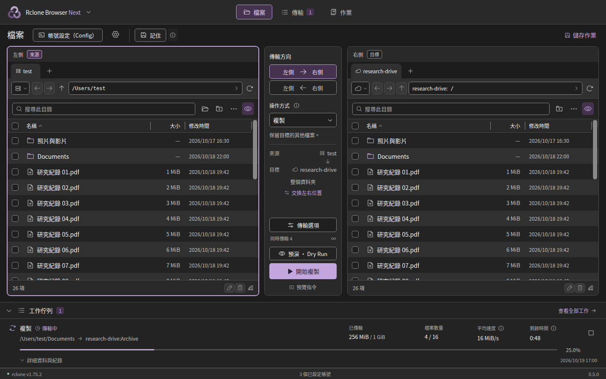

  

<h1 align="center">Rclone Browser Next</h1>

  

*由介面程式產生的預覽，使用示意檔案與路徑。*

  <a href="https://github.com/jason840709/RcloneBrowserNext/releases/latest">下載</a> ·
  <a href="README.en.md">English</a> ·
  <a href="README.zh-TW.md">使用手冊</a> ·
  <a href="https://github.com/jason840709/RcloneBrowserNext/issues">回報問題</a>

**Mac 是主要開發平台**，另提供 Windows x64 與 Linux amd64 相容版；三平台使用同一個正式版本。[下載與更新說明](https://github.com/jason840709/RcloneBrowserNext/releases/latest) · [相容版安裝](docs/BUILD_COMPATIBILITY.md)

## 這是什麼？

Rclone Browser Next 是由 **Jason Chen** 開發的 macOS [rclone](https://rclone.org/) 圖形介面。
左右兩邊都能選擇本機資料夾、雲端空間或 NAS／伺服器，再從中央選擇方向，複製、移動或同步檔案。

## 為什麼做 Next？

Jason 在自己的 Mac 上遇過舊版 Rclone Browser 的安裝相容性問題；搭配現行 rclone 使用時，速度和剩餘時間的顯示也不可靠。
他因此希望保留原版的圖形操作流程，同時改善 Mac 相容性和傳輸資訊。

**原版的預設工作流程側重本地與雲端之間的上傳、下載。** Next 讓左右位置都能自由選擇，把本機對本機、雲端對雲端也放進同一套操作流程。
實際傳輸仍由 rclone 執行；這裡擴充的是介面上的操作方式。

## 與 Rclone Browser 1.8 的差異

### 左右位置都能自由選

選好兩邊，再決定往哪個方向傳。NAS 可以使用 Finder 已掛載的資料夾，也可以使用 rclone 設定的遠端連線。

| 傳輸組合 | 使用範例 |
| --- | --- |
| 本機 ↔ 本機 | Mac 資料夾、外接硬碟、已掛載的 NAS 之間複製或備份 |
| 本機 ↔ 雲端 | 將本機資料上傳，或把雲端資料下載回來 |
| 雲端 ↔ 雲端 | 在兩個已設定的雲端位置之間複製、移動或同步 |

雲端之間能否直接複製，取決於服務支援；跨服務傳輸的資料通常仍會經過執行 rclone 的 Mac。[傳輸路徑說明](https://rclone.org/faq/#can-rclone-sync-directly-from-drive-to-s3)

### 支援 Apple Silicon，使用 Mac 內建元件

App 使用 Swift／AppKit 與 macOS 內建 WebKit，支援 Apple Silicon 與 Intel；rclone 獨立安裝在你選的資料夾。
安裝包使用系統已有的介面元件，不需要把另一套瀏覽器引擎放進 App。[架構與建置說明](docs/DEVELOPMENT.md)

### 分頁、作業與傳輸記錄

Dry Run 和 Tasks 是延續原版的重要功能。Next 把它們與雙面板放在一起，並補上日常操作需要的細節：

- **資料夾分頁：** 左右各自保留分頁與瀏覽歷史，可用滑鼠側鍵返回、前進。
- **預演與儲存作業：** 先用 Dry Run 查看預計動作；常用設定存成 Task，之後可執行、預演、編輯或刪除。
- **常用備份方案：** 提供本機、NAS 與雲端的六種常用方案，可再調整比對與排除規則。
- **儲存工作區：** 下次開啟時還原左右資料夾與傳輸設定，不會自動開始工作。
- **進度與提示：** 顯示平均速度、剩餘時間與一位小數的百分比；短暫通知懸浮顯示，不推動原本版面。
- **工作記錄：** 分開顯示已檢查與需傳輸的數量，並提供逐檔略過、完成和錯誤報告。可停止、重試或清除工作；停止中的狀態會保留到 rclone 真正結束。
- **外觀與語言：** 黑紫、淺紫、黑藍、淺藍、黑綠、淺綠六種主題，搭配五段介面大小；繁體中文、English、日本語，支援跟隨系統語言。

同步採單向方式：**以來源為準，只修改目標，並可能刪除目標中多出的檔案。** 比對、排除與略過規則仍會影響範圍；執行前可先預演。[完整操作說明](README.zh-TW.md)

NAS 方案預設依大小與修改時間比對、不計算本機雜湊，可以減少為了比對而讀回整份 NAS 檔案的流量；代價是少了本機端的內容雜湊校驗。選項仍可調整，[NAS 比對說明](docs/NAS_COMPARISON.zh-TW.md) 列出各種情境的取捨。

### rclone 與 App 分開更新

可以在啟動時或手動檢查 rclone 新版，選擇更新、稍後處理或跳過該版本。確認更新後，引擎會下載並替換到指定的安裝位置。
App 另有「檢查 Rclone Next 更新」，查詢本專案的正式 Release，有新版時提供下載頁；更新引擎不必重建整個 App。

## 快速開始

需要 **macOS 13 以上**。本機建置使用 Mac 已有的 **Xcode 或 Apple Command Line Tools**。

1. 到 [最新發布頁](https://github.com/jason840709/RcloneBrowserNext/releases/latest) 下載本機建置包，完整解壓縮。
2. 雙擊 `Build-on-Mac.command`，在同一個資料夾產生並開啟 App。
3. 在設定選擇 **rclone 安裝位置**，使用既有引擎或下載到所選資料夾；透過 **帳號設定（Config）** 加入遠端連線，再選好左右位置並預演。

建置不會自行安裝開發工具、Homebrew、Node.js 或 rclone；編譯快取與產物留在專案資料夾。
App 採 **ad-hoc 本機簽章**，尚未取得 Developer ID 簽章與 Apple 公證；若下載後遭到 Gatekeeper 阻擋，請依 [Mac 建置說明](docs/BUILD_MAC.zh-TW.md) 操作。

## 文件與回報

| 文件 | 內容 |
| --- | --- |
| [使用手冊](README.zh-TW.md) | 瀏覽、傳輸、Tasks、設定與更新 |
| [Mac 建置說明](docs/BUILD_MAC.zh-TW.md) | 安裝需求、檔案位置、簽章與問題排查 |
| [NAS 比對方式](docs/NAS_COMPARISON.zh-TW.md) | 減少額外內容讀取的方法，以及比對準確度的取捨 |
| [與原版的功能對照](docs/FEATURE_MATRIX.zh-TW.md) | 保留的功能、實作方式與差異 |
| [修改記錄](docs/CHANGELOG.zh-TW.md) | 各版本更新內容 |
| [開發說明](docs/DEVELOPMENT.md) · [驗證記錄](docs/VALIDATION.zh-TW.md) | 原始碼建置、測試方法及已驗證範圍 |

遇到問題或有功能建議，請在 [Issues](https://github.com/jason840709/RcloneBrowserNext/issues) 說明操作步驟、App／rclone 版本與 macOS 版本。

## 作者與致謝

作者：**Jason Chen**。程式採 [MIT License](LICENSE)，圖示由 Jason Chen 提供。

- [rclone](https://rclone.org/) 與其開發者：提供儲存服務連線與檔案傳輸引擎。
- [mmozeiko／RcloneBrowser](https://github.com/mmozeiko/RcloneBrowser)：原始 Rclone Browser 專案與圖形操作的基礎。
- [kapitainsky／RcloneBrowser](https://github.com/kapitainsky/RcloneBrowser)：延續原專案的維護版本，提供本專案研究的功能與工作流程。

Next 是以 Swift／AppKit 與 React 實作的獨立專案，並非原版的官方新版。
第三方前端套件聲明隨 [Web 資源](Resources/Web/THIRD_PARTY_NOTICES.txt) 附上。
