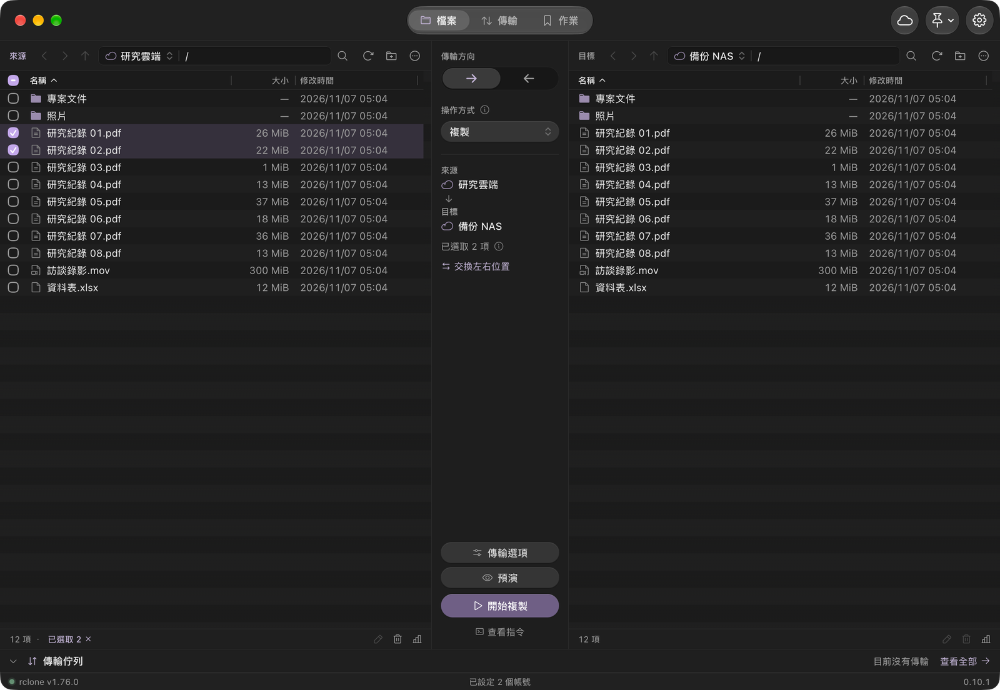
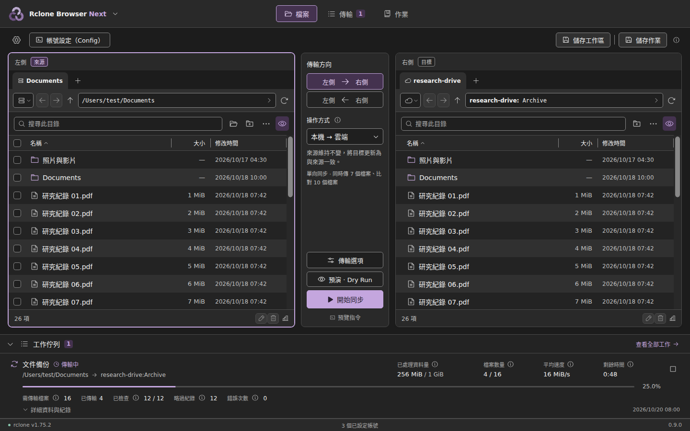

  

<h1 align="center">Rclone Browser Next</h1>

  

*0.10.1 Mac 版實機畫面（使用測試帳號與示意檔案）。Windows 與 Linux 版介面相同，僅視窗外框隨系統變化。*

  <a href="https://github.com/jason840709/RcloneBrowserNext/releases/latest">下載</a> ·
  <a href="README.en.md">English</a> ·
  <a href="README.ja.md">日本語</a> ·
  <a href="docs/USER_GUIDE.zh-TW.md">使用手冊</a> ·
  <a href="https://github.com/jason840709/RcloneBrowserNext/issues">回報問題</a>

## 這是什麼？

Rclone Browser Next 是 **Jason Chen** 開發的 [rclone](https://rclone.org/) 圖形介面，支援 Mac、Windows 與 Linux。
左右面板都能任選本機資料夾、雲端或 NAS／伺服器，再從中央指定方向來複製、移動或同步檔案，底層傳輸由 rclone 執行。

## 支援系統與穩定度

三個系統共用版本號並同步發布。

| 系統 | 下載檔案 | 穩定度 |
| --- | --- | --- |
| macOS 13 以上（Apple 晶片、Intel） | `macOS_arm64.zip`（Apple 晶片）或 `macOS_x86_64.zip`（Intel） | **最穩定。** 在 Mac 上開發、作者每天自用，每次發布都會在 GitHub Mac 測試機跑完原生與介面測試。 |
| Windows x64 | `Windows_x64_Setup.exe` | 由 GitHub 測試機建置，自動測試全新安裝、舊版升級、檔案操作與複製。作者平時不用 Windows，穩定度可能不及 Mac 版。 |
| Linux（Ubuntu 24.04 amd64） | `Linux_amd64.deb` | 由 GitHub Ubuntu 測試機建置，自動測試檔案操作、複製與取消。作者平時不用 Linux；其他發行版需自行安裝相依套件或從原始碼建置。 |

Windows 與 Linux 版共用相同的介面與傳輸核心，支援瀏覽、複製、單向同步、移動、預演、作業與逐檔報告；Finder 整合、選單列圖示與掛載僅限 Mac 版。[Windows／Linux 安裝與建置](docs/BUILD_COMPATIBILITY.md)

**遇到任何問題都歡迎到 [Issues](https://github.com/jason840709/RcloneBrowserNext/issues) 回報。** 問題再小都沒關係，Windows 和 Linux 的回報尤其有幫助。

## 最近版本

- [0.12.0](docs/RELEASE_0.12.0.md)：Windows 與 Linux 的安裝包變小；介面和操作方式維持原樣，原有設定與傳輸歷程可繼續使用。
- [0.11.0](docs/RELEASE_0.11.0.md)：整理介面、錯誤提示與使用手冊，讓同步、檔案比對與重試的說明更容易理解。
- [0.10.6](docs/RELEASE_0.10.6.md)：新增 SMB 直連、NAS 連線方式標示與 Mac 視窗雙擊縮放。

- [0.10.3](docs/RELEASE_0.10.3.md)：等雲端確認檔案時照常顯示速度並加上小轉圈；擴大滑鼠提示感應範圍；固定 Mac 工具列按鈕無外框。
- [0.10.2](docs/RELEASE_0.10.2.md)：傳輸速度只計實際傳輸時間；統計改依檔案去向分類；錯誤改用燈號與白話說明。
- [0.10.1](docs/RELEASE_0.10.1.md)：修正清單捲到底回彈、設定提示不消失等問題。
- [0.10.0](docs/RELEASE_0.10.0.md)：重新設計介面，支援自動淺色／深色外觀與低彩度配色。

完整紀錄見 [修改記錄](docs/CHANGELOG.zh-TW.md)。

## 為什麼做 Next？

Jason 在 Mac 上用舊版 Rclone Browser 時遇過安裝相容性問題，搭配新版 rclone 時速度與剩餘時間也不準確，因此決定保留原版的操作邏輯，重新打造相容性更好、傳輸資訊更清楚的版本。

**原版流程以本機與雲端上下傳為主；** Next 改為左右雙面板自由選取，把本機對本機、雲端對雲端也放進同一套操作流程。

## 與 Rclone Browser 1.8 的差異

### 左右位置自由選

選好兩側位置再決定傳輸方向。NAS 可直接選系統已掛載的資料夾，或使用 rclone 設定的遠端連線。

| 傳輸組合 | 使用範例 |
| --- | --- |
| 本機 ↔ 本機 | 電腦資料夾、外接硬碟、已掛載 NAS 之間複製或備份 |
| 本機 ↔ 雲端 | 本機資料上傳雲端，或從雲端下載回本機 |
| 雲端 ↔ 雲端 | 兩個雲端帳號之間複製、移動或同步 |

雲端之間能否直接對傳取決於服務商支援，跨服務傳輸通常仍會經過執行 rclone 的電腦。[傳輸路徑說明](https://rclone.org/faq/#can-rclone-sync-directly-from-drive-to-s3)

### 使用系統內建元件

Mac 版採用 Swift／AppKit 與系統內建 WebKit（支援 Apple 晶片與 Intel）；Windows 與 Linux 版透過 Tauri 搭配系統內建網頁元件（Windows WebView2、Linux WebKitGTK）。
三個平台都不必內嵌龐大的瀏覽器引擎，rclone 則獨立安裝在你指定的資料夾。[架構與建置說明](docs/DEVELOPMENT.md)

### 分頁、作業與傳輸紀錄

延續原版的預演（Dry Run）與作業（Tasks），並結合雙面板補齊日常所需細節：

- **資料夾分頁：** 左右各自保留分頁與瀏覽紀錄，支援滑鼠側鍵返回、前進。
- **瀏覽快取與取消：** 回訪雲端資料夾時直接讀取快取；重新整理會清除該側快取，載入途中也可隨時取消並退回原位置。
- **預演與儲存作業：** 傳輸前可先預演（Dry Run）確認動作；常用設定可存成作業（Task），隨時執行、預演或編輯。
- **常用備份方案：** 內建本機、NAS 與雲端六種常用方案，套用後仍可微調比對與排除規則。
- **儲存工作區：** 下次開啟時自動還原左右資料夾與傳輸設定（不會自動開始傳輸）。
- **進度與速度：** 速度只算實際傳檔時間，並顯示剩餘時間與小數點後一位百分比；比對檔案或等待雲端確認時，速度旁會顯示小轉圈與提示。
- **工作紀錄：** 列出不用傳、已略過、已刪除數量與錯誤次數，並提供逐檔報告。錯誤訊息翻成白話：會自動重試的亮橘燈，需手動處理的亮紅燈。
- **外觀與語言：** 紫、藍、綠三色主題（各含淺色／深色）與五段介面縮放；支援繁體中文、English、日本語與跟隨系統語言。

同步為單向同步：**以來源為準更新目標，刪除同步範圍內目標多出的檔案。** 排除規則、略過條件、刪除上限與讀取錯誤都可能影響結果；工作顯示失敗時，請先查看錯誤。執行前建議先預演。[完整操作說明](docs/USER_GUIDE.zh-TW.md)

雜湊是依檔案內容算出的核對值。NAS 方案預設比對大小與修改時間、不計算本機雜湊，避免為了比對把整份 NAS 檔案讀回電腦；各情境的取捨見 [NAS 比對說明](docs/NAS_COMPARISON.zh-TW.md)。

### rclone 與 App 獨立更新

可在啟動時或手動檢查 rclone 更新，確認後直接下載替換指定位置的 rclone。
選單另有「檢查 Rclone Next 更新」，可查詢 GitHub 最新正式版並前往下載頁。

## 快速開始

1. 到 [最新發布頁](https://github.com/jason840709/RcloneBrowserNext/releases/latest) 下載對應系統的安裝檔：
   - **Mac：** 解壓縮後將 `Rclone Browser Next.app` 拖進「應用程式」。App 僅有本機簽章、未經 Apple 公證，首次打開若被擋下，請到「系統設定 → 隱私權與安全性」下方點擊「強制打開」。
   - **Windows：** 執行 `Setup.exe`（安裝在目前使用者下，免管理員權限）。若出現 SmartScreen 警告，點「其他資訊」→「仍要執行」。缺少 WebView2 時安裝程式會自動從 Microsoft 下載。
   - **Linux（Ubuntu 24.04）：** 用套件安裝程式開啟 `.deb`，或執行 `sudo apt install ./Rclone_Browser_Next_<版本>_Linux_amd64.deb`。
2. 在「設定」指定 **rclone 安裝位置**：可直接選用已安裝的 rclone，或下載到指定資料夾。
3. 點擊 **帳號設定 → 快速設定**，輸入名稱並選擇服務：Google Drive、OneDrive、Dropbox 會開啟瀏覽器登入；NAS／伺服器則填入位址與帳密。進階選項在 **詳細設定**，旁邊的 **config** 可開啟傳統終端機設定。
4. 選好左右兩側位置，先按 **預演** 確認動作，再開始傳輸。

若想從原始碼自行建置：Mac 版請下載同頁的 `Source.zip`，雙擊 `Build-on-Mac.command`（[Mac 建置說明](docs/BUILD_MAC.zh-TW.md)）；Windows 與 Linux 版請見 [相容版建置](docs/BUILD_COMPATIBILITY.md)。

## 舊版介面（0.9.6 以前）

0.9.6 以前採用下圖的介面，0.10.0 起改為現行設計。若偏好舊版畫面，可至 [0.9.6 發布頁](https://github.com/jason840709/RcloneBrowserNext/releases/tag/v0.9.6) 下載。

## 文件與回報

| 文件 | 內容 |
| --- | --- |
| [使用手冊](docs/USER_GUIDE.zh-TW.md) | 瀏覽、傳輸、作業、設定與更新說明 |
| [Windows／Linux 安裝與建置](docs/BUILD_COMPATIBILITY.md) | 相容版安裝、建置與測試說明（英文） |
| [Mac 建置說明](docs/BUILD_MAC.zh-TW.md) | 從原始碼建置 Mac 版、檔案位置、簽章與故障排除 |
| [NAS 比對方式](docs/NAS_COMPARISON.zh-TW.md) | 減少 NAS 額外讀取流量的方法與比對取捨 |
| [與原版的功能對照](docs/FEATURE_MATRIX.zh-TW.md) | 功能對照與架構說明 |
| [修改記錄](docs/CHANGELOG.zh-TW.md) | 歷次版本更新內容 |
| [開發說明](docs/DEVELOPMENT.md) · [驗證記錄](docs/VALIDATION.zh-TW.md) | 原始碼建置、測試方法與驗證範圍 |

有任何問題或建議都歡迎到 [Issues](https://github.com/jason840709/RcloneBrowserNext/issues) 提出，回報時請附上系統版本、App 版本、rclone 版本與操作步驟（有截圖更好）。

## 作者與致謝

作者：**Jason Chen**。採用 [MIT License](LICENSE)，應用圖示由 Jason Chen 設計。

- [rclone](https://rclone.org/) 與開發團隊：提供儲存服務連線與檔案傳輸引擎。
- [mmozeiko／RcloneBrowser](https://github.com/mmozeiko/RcloneBrowser)：原始 Rclone Browser 專案。
- [kapitainsky／RcloneBrowser](https://github.com/kapitainsky/RcloneBrowser)：延續原專案的維護分支，為本專案的功能與流程參考基礎。

Next 是獨立實作的專案，並非原版的官方續作：前端以 React 編寫，Mac 版外框用 Swift／AppKit，Windows 與 Linux 版用 Tauri，並共用 Rust 傳輸核心。
第三方前端套件聲明隨附於 [Web 資源](Resources/Web/THIRD_PARTY_NOTICES.txt)。
